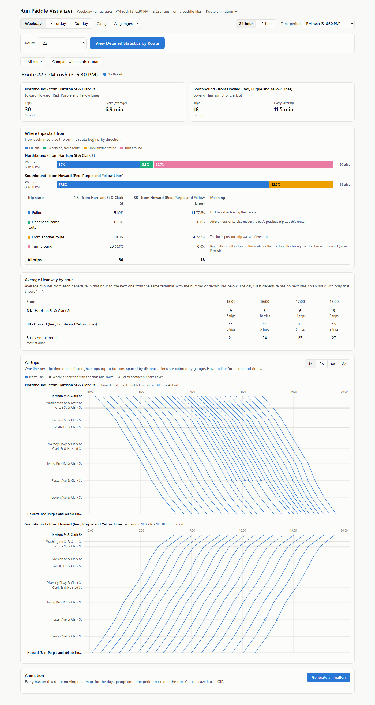
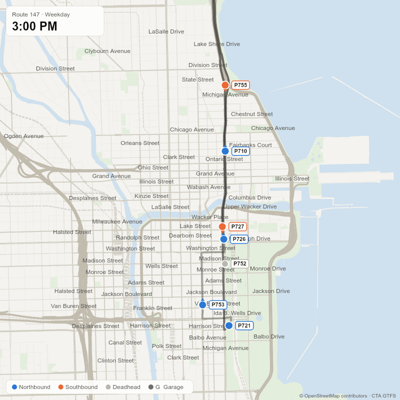

# CTA Run Paddle Reader

Shows how CTA bus service is actually scheduled, using the CTA's own operator schedules (**run paddles**) instead of the public GTFS timetable.

GTFS says when buses stop. Paddles show what GTFS doesn't:
- **reliefs:** when and where operators hand off buses;
- **deadheads, pullouts and pull-ins:** when they happen and which streets they use;
- **how each trip begins;**
- **how many buses are really in service.**

## What's included

The **Summer 2026** paddles (via FOIA) for all seven garages, Weekday, Saturday and Sunday. They're included as PDFs (`Summer 2026 Runs/`) and already parsed (`* Parsed/`), with pre-built map and animation data, so no build step is needed. The reader works on any CTA paddles in the same format (HASTUS "cscr60").

## Features

- **Summary statistics** by day, garage and time period: first and last trips, departures, frequency.
- **Route pages:**
  - where trips come from;
  - hourly headways and peak buses;
  - string graphs with reliefs marked;
  - side-by-side comparison of two routes.
- **Animations** of scheduled service for a route or a whole garage, including deadheads and route changes. They export as GIFs.
- **JSON data** for every run, its trips, reliefs and statistics.

## Samples

**Route 22, weekday PM rush**



**Route 147, weekday 3–6:30 PM.** Buses show run numbers, colored by direction. Pullouts and pull-ins are grey "G".



## Install and run

Requires [Node.js](https://nodejs.org) 22.13+ and [Git](https://git-scm.com).

```
git clone https://github.com/kb-chi/cta-run-paddle-reader.git
cd cta-run-paddle-reader
npm install
npm run viz
```

Open <http://localhost:5280>. Stop the server with Ctrl+C.

## Adding new paddles

1. **Parse each PDF** for one garage and day:

   ```
   node read-paddles.js "North_Park_Weekday.pdf" -o "Weekday Parsed/North Park Weekday Runs Parsed.json"
   ```

   PDFs must have real text (not scans). Remove the old season's files first: every file in the `Parsed` folders is loaded.
2. **Check `problems`** in each output file. Add unknown time points to `LOCATIONS` and `COORDS` in `locations.js`, then re-parse.
3. **If routes changed:** put `shapes.txt`, `trips.txt` and `routes.txt` from [CTA's GTFS](https://www.transitchicago.com/downloads/sch_data/google_transit.zip) in `CTA GTFS/`, then run `node "CTA GTFS/make-route-shapes.mjs"`.
4. **Optionally refresh the map:** `node osm/fetch.mjs .` then `node osm/compact.mjs .`.
5. **Rebuild animation paths:** `node animation/build-paths.mjs`. Fix misspelled "VIA" street names in `animation/via.js`.
6. **Restart** the visualizer.

## Notes

- **Animations:** buses move evenly between time points, 3× as fast on expressways. Out-of-service moves follow the streets in each paddle's "VIA" note.
- **Pay** is recalculated from its parts. Mismatches with the printed pay are listed in `problems`.
- **Times** keep counting past midnight (01:01 → `25:01:00`). A "+" on the paddle means +30 seconds.
- **24/7 routes:** routes with a last trip after 2 AM and a first trip before 4 AM show "24/7 route". The N5 is an "Overnight circulator".
- **Run objects:** their full structure is documented at the top of `run.js`.

## Files

| Path | Purpose |
|---|---|
| `read-paddles.js`, `paddle-parser.js`, `pdf-text.js` | Read paddle PDFs |
| `run.js` | Run structure and statistics |
| `locations.js`, `locations-gtfs.js` | Time-point names and coordinates |
| `visualizer/` | Web page, animation player, server |
| `animation/` | Builds bus paths |
| `osm/`, `CTA GTFS/` | Map and route-line data |
| `tests/`, `example-p001.js` | Tests (`npm test`) |

Data: CTA run paddles (FOIA), CTA GTFS, © OpenStreetMap contributors (ODbL).
